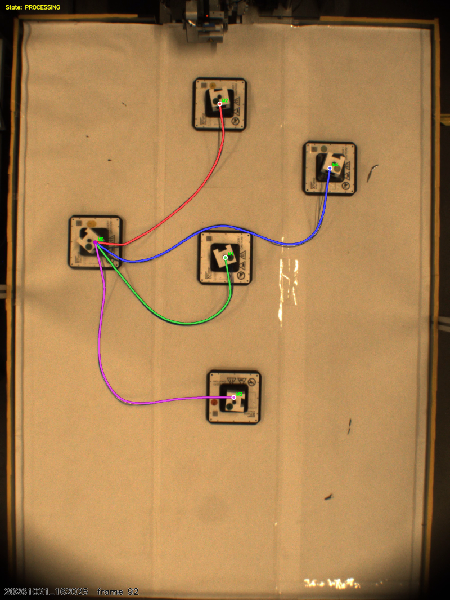

# Skeleton-Refined Cable Tracking

Perception pipeline for extracting 4-cable wire harness shapes from video recordings.
Combines two complementary sources to produce smooth, complete cable trajectories:

| Source | What it provides |
|---|---|
| **Class map** (`02_class_map.png`, yellow channel) | Wire identity mask for the perception pipeline tracer -- reliable 4-cable assignment |
| **X-planner skeleton** (`03_1_full_skeleton.png`) | Sub-pixel cable shape -- each pipeline cable is attracted toward nearby skeleton pixels via cKDTree, then Gaussian-smoothed |

The result is 4 smooth cables (hub to module), each resampled to 16 equidistant nodes,
with no gaps, no branches, no floating segments, and no sharp corners.

## Folder structure

```
skeleton_refined/
  scripts/
    track_skeleton_refined.py   # Main entry point
  wire_model/
    perception/                 # Perception library (rectify, trace, track, segment, ...)
  example/
    combined_20261021_162025_frame082.png   # Sample output frame
  README.md
```

## Requirements

- Python 3.9+
- OpenCV (`opencv-python`)
- NumPy, SciPy
- imageio
- scikit-image (`skimage`)

Install:
```bash
pip install opencv-python numpy scipy imageio scikit-image
```

## Input data

The script expects the **X-planner skeletonization** output folder as `--root`.
Each clip subfolder (e.g. `20261021_162025/`) must contain:

```
<root>/
  <clip>/
    00_source.mp4               # Original video recording
    02_class_map.png            # Class map with yellow channel = wire mask
    03_1_full_skeleton.png      # Full skeleton overlay (red channel = skeleton pixels)
```

These are produced by the X-planner skeletonization pipeline (not included here).

## Usage

Run from inside `skeleton_refined/`:

```bash
# Process all clips found under --root
python scripts/track_skeleton_refined.py --root /path/to/X-planner_skeletonization --out output

# Process a single clip
python scripts/track_skeleton_refined.py --root /path/to/X-planner_skeletonization --out output --clip 20261021_162025
```

### Arguments

| Flag | Default | Description |
|---|---|---|
| `--root` | (required) | Path to the X-planner skeletonization folder |
| `--out` | `output` | Output directory (created if needed) |
| `--clip` | all | Process only this clip name |
| `--sigma` | `3.0` | Gaussian smoothing sigma (frames) for temporal filtering |
| `--attract` | `12.0` | Attraction radius (px) toward skeleton pixels |

## Output format

For each clip, the script produces:

### NPZ file (`<clip>.npz`)

Contains the tracked cable shapes in board coordinates (metres):

| Key | Shape | Description |
|---|---|---|
| `c0` .. `c3` | `(T, 16, 2)` | Cable node positions in metres (board frame), 16 equidistant nodes per cable per frame |
| `fps` | scalar | Video frame rate |
| `t0`, `t1` | scalar | First and last source frame index |
| `source_frames` | `(T,)` | Mapping from output frame index to source video frame index |

### Comparison video (`combined_<clip>.mp4`)

Side-by-side video with:
- **Left panel**: original video frame with tracked cables overlaid (coloured polylines with node markers)
- **Right panel**: skeleton overlay with the same tracked cables drawn on top

Colours per cable: red (c0), blue (c1), green (c2), magenta (c3).

### Sample frame (`combined_<clip>_frame<N>.png`)

A single PNG frame from the middle of the video for quick visual inspection.

## How it works

1. **Board detection**: Finds the calibration board in frame 0 to establish the mm-to-pixel transform.
2. **Wire mask extraction**: Reads the class map's yellow channel as the wire segmentation mask.
3. **Perception pipeline**: Runs the harness tracker (module detection + cable tracing) on every frame using the wire mask.
4. **Skeleton attraction**: For each tracked cable, nearby skeleton pixels (within `--attract` radius) pull the cable nodes toward sub-pixel positions using a cKDTree lookup.
5. **Gaussian smoothing**: Temporal smoothing with `--sigma` removes frame-to-frame jitter.
6. **16-node resampling**: Each cable is resampled to 16 equidistant nodes in board metres, compatible with the evaluation format used throughout this repository.

## Example result

Below is a sample output frame showing tracked cables on the real video (left) and skeleton overlay (right):



## Tested clips

The pipeline has been validated on 8 clips:

| Clip | Frames | Status |
|---|---|---|
| 20261021_160124 | 166 | OK |
| 20261021_162025 | 165 | OK |
| 20261021_162340 | 175 | OK |
| 20261021_162632 | 171 | OK |
| 20261021_162931 | 169 | OK |
| 20261021_163244 | 123 | OK |
| 20261021_163624 | 170 | OK |
| 20261028_124829 | 155 | OK |
